  
    
  

## Hi, I'm DONG Enlong 👋

I'm a Computer Science undergraduate at **The Hong Kong Polytechnic University** (Class of 2028). I work at the intersection of **AI, music, and product development**: studying how language models compose music, and turning AI tools into workflows people can actually use.

| 🎓 Education | 🔬 Research | 💼 Experience |
| :-- | :-- | :-- |
| PolyU BSc (Hons) in Computer Science | PolyU **URIS** researcher, supervised by Dr. LIU Yan Fiona | **Futu Holdings** · **Tencent Music Entertainment** |

## Research · AI meets music

My URIS project explores **AI-driven music composition with theory-guided constraints and real-time interaction**. I compare how LLMs interpret composition prompts, evaluate outputs across **fluency, flexibility, elaboration, and originality**, and investigate whether deliberative reasoning changes their compositional choices.

## Selected work

### 💡 AI product work · Futu Holdings

Led the development of an AI-enabled product management knowledge base combining voice input, PRD drafting, architecture drafting, and interactive prototype review. Delivered four AI enablement sessions for **50+ product managers** and worked on data-reporting requirements for a cryptocurrency anti-scam compliance upgrade.

### 🎵 AI music product work · Tencent Music Entertainment

Supported the development and launch of **Vemus**. Built a structured framework for assessing AI-generated songs and used creator and beta-user feedback to identify quality and user-experience issues.

## Programming languages

  
   
  Python · Java · C++ · R

**Other interests:** LLM evaluation · AI product development · data analysis · database systems · digital assets and payments

## Recognition

PolyU Scholarship · Aaron Lam Scholarship · HKSAR Reaching Out Award · Dean's List, Faculty of Engineering

## Connect

📫 [24110812d@connect.polyu.com](mailto:24110812d@connect.polyu.com) · 🌏 Hong Kong / Shenzhen
